<a href="https://github.com/jeancarloscc">
  <picture>
    <source media="(prefers-color-scheme: dark)" srcset="https://capsule-render.vercel.app/api?type=waving&height=170&color=0F2F38&text=Olá,%20sou%20Jean%20Carlos&fontSize=46&fontAlignY=36&desc=Doutorando%20em%20Ciência%20da%20Computação%20·%20Visão%20Computacional%20e%20LLMs&descSize=17&descAlignY=58&section=header&reversal=false&textBg=false&fontColor=F5F1E8">
    
  </picture>
</a>

<!-- TODO: troque SEU_ID_LATTES e SEU_ORCID pelos seus identificadores -->

  <a href="mailto:jeancc.costa@gmail.com" title="E-mail"><picture><source media="(prefers-color-scheme: dark)" srcset="https://raw.githubusercontent.com/jeancarloscc/jeancarloscc/main/assets/mail-dark.svg"></picture></a>&nbsp;
  <a href="https://www.linkedin.com/in/jeancc-costa/" title="LinkedIn"><picture><source media="(prefers-color-scheme: dark)" srcset="https://raw.githubusercontent.com/jeancarloscc/jeancarloscc/main/assets/linkedin-dark.svg"></picture></a>&nbsp;
  <a href="http://lattes.cnpq.br/SEU_ID_LATTES" title="Currículo Lattes"><picture><source media="(prefers-color-scheme: dark)" srcset="https://raw.githubusercontent.com/jeancarloscc/jeancarloscc/main/assets/lattes-dark.svg"></picture></a>&nbsp;
  <a href="https://orcid.org/SEU_ORCID" title="ORCID"><picture><source media="(prefers-color-scheme: dark)" srcset="https://raw.githubusercontent.com/jeancarloscc/jeancarloscc/main/assets/orcid-dark.svg"></picture></a>&nbsp;
  <a href="https://www.instagram.com/jeancc.costa/" title="Instagram"><picture><source media="(prefers-color-scheme: dark)" srcset="https://raw.githubusercontent.com/jeancarloscc/jeancarloscc/main/assets/instagram-dark.svg"></picture></a>

<picture>
  <source media="(prefers-color-scheme: dark)" srcset="https://raw.githubusercontent.com/jeancarloscc/jeancarloscc/main/assets/areas-dark.svg">
  
</picture>

🎓 Doutorando no PPGCC/UFPA e mestre em Ciência da Computação. 
🔬 Pesquisador no Laboratório de Inteligência de Dados (LID/UFPA). Trabalho com visão computacional e aprendizado de máquina para detectar estresse hídrico em açaizeiros, e com avaliação de LLMs em exames educacionais. 
👨‍🏫 Atuo em ensino e extensão: integro a equipe do PROLIA, programa de letramento em IA da UFPA, e oriento alunos na escrita e submissão de trabalhos científicos. 
📱 Em projetos pessoais, desenvolvo apps em Flutter integrados a IA generativa. 
💬 Aberto a colaborações em visão computacional, LLMs e IA aplicada à educação.

### Tecnologias & Ferramentas

#### IA e ciência de dados

  
  
  
  
  <picture>
    <source media="(prefers-color-scheme: dark)" srcset="https://raw.githubusercontent.com/jeancarloscc/jeancarloscc/main/assets/pandas-dark.svg">
    
  </picture>
  
  <picture>
    <source media="(prefers-color-scheme: dark)" srcset="https://raw.githubusercontent.com/jeancarloscc/jeancarloscc/main/assets/scikitlearn-dark.svg">
    
  </picture>
  
  
  
  
  
  
  
  

#### Desenvolvimento

  
  
  
  
  
  
  

#### Ambiente e pesquisa

  
  
  
  
  
  
  <picture>
    <source media="(prefers-color-scheme: dark)" srcset="https://raw.githubusercontent.com/jeancarloscc/jeancarloscc/main/assets/github-dark.svg">
    
  </picture>
  
  <picture>
    <source media="(prefers-color-scheme: dark)" srcset="https://raw.githubusercontent.com/jeancarloscc/jeancarloscc/main/assets/latex-dark.svg">
    
  </picture>

### Estatísticas

  <picture>
    <source media="(prefers-color-scheme: dark)" srcset="https://github-readme-stats-bay-two-54.vercel.app/api?username=jeancarloscc&hide_title=false&hide_rank=false&show_icons=true&include_all_commits=true&count_private=true&disable_animations=false&locale=pt-br&hide_border=false&bg_color=0F2F38&title_color=8FC3CE&icon_color=8FC3CE&text_color=E6E1D6&ring_color=8FC3CE&border_color=2A5D69">
    
  </picture>
  <picture>
    <source media="(prefers-color-scheme: dark)" srcset="https://github-readme-stats-bay-two-54.vercel.app/api/top-langs?username=jeancarloscc&locale=pt-br&hide_title=false&layout=compact&card_width=350&langs_count=6&hide_border=false&hide=jupyter%20notebook&bg_color=0F2F38&title_color=8FC3CE&text_color=E6E1D6&border_color=2A5D69">
    
  </picture>

